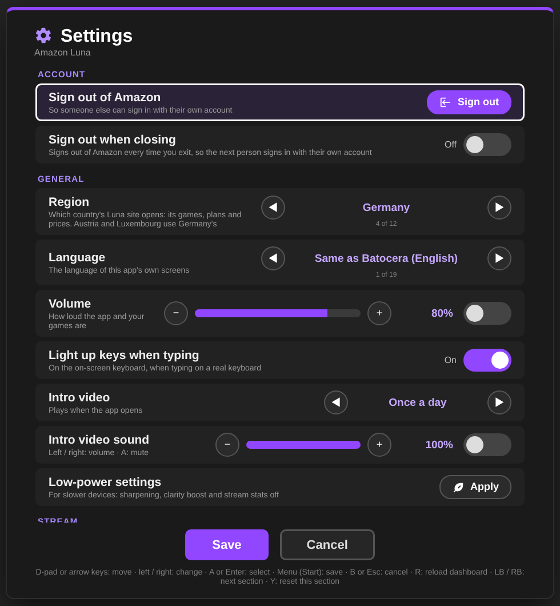

# Amazon Luna for Batocera & HippOS

Play **Amazon Luna** from the EmulationStation carousel on [Batocera](https://batocera.org) and [HippOS](https://hippos-linux.org). Pick it, and a fullscreen app opens on [luna.amazon.com](https://luna.amazon.com), ready for your controller. Your Luna games can sit in EmulationStation's list like any other system, with their pictures and descriptions.

**[⬇ Download the latest release](https://github.com/rmach89/luna-batocera-hippos/releases/latest)**

> **Unofficial project, use at your own risk.** Not affiliated with, endorsed by or sponsored by Amazon. Amazon, Amazon Luna, Luna and Prime are trademarks of Amazon.com, Inc. or its affiliates.



What changed in each version: [CHANGELOG.md](CHANGELOG.md).

## Features

**The app**
- A fullscreen Amazon Luna app of its own (no Chrome install needed) that works entirely with a controller. It has an on-screen keyboard for signing in and searching, and a number pad for codes.
- It only goes to Amazon's own sites (Luna in every country it's offered, Amazon sign-in and account pages). Every other link, popup and download is blocked.
- Luna turns Linux browsers away, so the app tells it it's Chrome on Windows. Nothing to set up.
- **Back up and restore** the settings (not the sign-in) as one file in the share folder, for a new device or after reinstalling.
- **Safe mode**: if the picture ever goes black or breaks up, hold LB + RB while the app opens; the graphics options turn off so you can start again from there.
- The app's own screens are in 18 languages and follow the system's language by default.

**Stream and picture** (Settings)
- **Picture**: sharpening, Clarity boost, and sliders for contrast, colour saturation and brightness.
- **Stream stats**: resolution, frame rate, ping, bitrate, packet loss and decode time, shown at the top while you play.
- **Quick settings in a game** (hold LB + RB + View, or F9): volume and picture over the game, stream stats and **screenshots** (saved to `/userdata/screenshots`).
- **GPU acceleration** (including hardware video decoding), for devices that need it.

**EmulationStation game list** (optional)
- **All Luna games** (every game on Luna's own list of its games, about 100 right now), **Games I pick** (add a game with F8 or LB + RB + LT + RT on its Luna page), or **Off** (just the app itself).
- Each game comes with its name, description and picture, from its own page on Luna. Picking a game opens the app on that game's page and presses Play for you.
- The list updates itself every few days. A progress bar in the bottom-left corner shows how far an update has got, and an update carries on in the background if you close the app.
- Amazon Luna itself always stays at the top of the list.

**Launch Single Game** (optional): picking Amazon Luna in the carousel opens the app straight away, and closing it takes you back to the carousel.

## What you need

- **Batocera or HippOS** on a 64-bit PC or a Steam Deck, or a 64-bit ARM device (see [Compatibility](#compatibility)).
- **An internet connection**: at least 10 Mbps. Wired or 5 GHz Wi-Fi is best.
- **An Amazon account** with a plan that includes Luna's cloud games (Prime or Luna Premium), in a country where they're offered: the US, Canada, the UK, Germany, Austria, France, Italy, Spain, the Netherlands, Poland, Belgium, Luxembourg, Portugal and Sweden.
- **About 400 MB free** in `/userdata`, for the browser engine the installer downloads.
- **A controller** (Xbox, PlayStation or Luna), or a keyboard and mouse.

## Install

### From the zip

1. Download the newest zip from **[Releases](https://github.com/rmach89/luna-batocera-hippos/releases/latest)**.
2. Unzip it into the share folder (`/userdata`, called "share" on the network). That gives you `/userdata/Amazon Luna`.
3. Open a terminal (on Batocera, F1 → Applications → xterm; or SSH in) and run:
   ```bash
   bash "/userdata/Amazon Luna/install.sh"
   ```
4. Answer its questions, then restart EmulationStation. Amazon Luna appears in the carousel.

### With just the installer

`install.sh` also works on its own. With nothing else next to it, it downloads the newest release from here, unpacks it into `/userdata/Amazon Luna` and installs it:

```bash
curl -fsSL https://raw.githubusercontent.com/rmach89/luna-batocera-hippos/main/install.sh -o /tmp/luna-install.sh
bash /tmp/luna-install.sh
```

The installer also works from BUA (Batocera Unofficial Add-ons): its questions appear on BUA's screen.

## First start

1. Pick **Amazon Luna** in the carousel. A short intro plays, then the welcome screen shows how to exit (hold View + Menu).
2. Press A. Luna opens. Sign in with your Amazon account: the on-screen keyboard comes up by itself on the sign-in boxes (A types, X deletes, Y capitals, Menu is Done).
3. You stay signed in. Next time, Luna opens straight to your games.

Luna's own pages follow the controller by themselves. If they don't on your setup, turn on Settings → Controller → **Move around Luna with the app**: the D-pad then moves between the page's buttons, A selects and B goes back.

## Updating

- **From the app:** Settings → Help and maintenance → **Updates**. One press checks for a newer app and a newer browser engine, and downloads whichever is newer. The new version is installed when you close the app; your sign-in, settings and picked games are kept.
- **Or run the installer again.** To skip its update check: `LUNA_NO_UPDATE_CHECK=1 bash install.sh`.

## Controls

| Action | Xbox | PlayStation | Keyboard |
|---|---|---|---|
| Exit back to EmulationStation | hold View + Menu (2 s) | hold Share/Create + Options | hold Esc |
| Welcome screen and Settings | hold Menu (1 s) | hold Options | hold S |
| Settings on Luna's pages | — | — | Backspace |
| Add or remove the current game in EmulationStation's list | hold LB + RB + LT + RT | hold L1 + R1 + L2 + R2 | F8 |
| Quick settings in a game (volume and picture) | hold LB + RB + View (1 s) | hold L1 + R1 + Share/Create | F9 |
| Screenshot in a game | Quick settings → Take a screenshot | the same | PrintScreen |
| Back to Luna from a sign-in or account page | View | Share/Create | Home |
| Settings: previous / next section | LB / RB | L1 / R1 | Page Up / Page Down |
| Safe mode (graphics options off) | hold LB + RB while the app opens (2 s) | hold L1 + R1 | `Run-App.sh --safe` |

## Settings

| Section | What's in it |
|---|---|
| Account | Sign out of Amazon, sign out when closing |
| General | Region (which country's Luna site), language, volume, key highlights, intro video and its sound, low-power settings |
| Stream | GPU acceleration, stream stats |
| Picture | Sharpening, Clarity boost, contrast, colour saturation, brightness |
| Controller | The full list of controls, move around Luna with the app, controller battery |
| EmulationStation | The game list (Off / All Luna games / Games I pick) |
| Help and maintenance | Reload dashboard, clear cache, save logs for help, back up settings, restore settings, updates |

## Controllers

- **Xbox, PlayStation and Luna controllers** are passed to Luna as they are; Luna supports them directly.
- **Steam controllers** (Steam Deck controls, Steam Controller) are shown to Luna as an Xbox controller, with the buttons in Xbox's layout.
- **Other controllers the browser doesn't recognise** are put into the Xbox layout, so the sticks, triggers and D-pad work.

## Compatibility

This is a new port, built from the [Xbox Cloud Gaming add-on](https://github.com/rmach89/xcloud-batocera-hippos), which is tested on 64-bit PCs (Batocera v42 and v44, HippOS 0.5) and the Steam Deck. The Luna version is **not fully tested yet** on any device. The app itself is the same, so it should run wherever the Xbox one does:

| | Devices |
|---|---|
| 🔸 Should play well | 64-bit PCs; Steam Deck and other PC handhelds; Raspberry Pi 5; RK3588 boards; Snapdragon handhelds |
| ⚠️ May stutter | Raspberry Pi 4 (2 GB+); Odroid N2; RK3566 / RK3568; newer Amlogic TV boxes |
| 🐢 Too slow | 1 GB devices and 32-bit ARM |
| ❌ Not supported | Raspberry Pi 1 / Zero (ARMv6) and 32-bit x86 PCs; the installer stops without changing anything |

Tried it? Let us know how it went in an [issue](https://github.com/rmach89/luna-batocera-hippos/issues).

## Uninstall

F1 → Applications → **Amazon Luna Uninstaller**, or:

```bash
bash /userdata/system/add-ons/luna/uninstall.sh
```

It asks before removing anything, and can keep your sign-in and settings for a reinstall. To remove everything without questions, add `--all`.

## FAQ

**Is this an official Amazon app?**
No. It's a fan-made add-on that opens Amazon's own Luna website in a fullscreen window made for controllers. You sign in with your own Amazon account.

**Is this BUA's "Amazon Luna"?**
No. BUA's add-on installs Google Chrome and opens Luna in it. This one is its own app: no Chrome, controller-only from start to finish, its own Settings, and Luna's games in EmulationStation's list.

**Which plan do I need?**
Prime includes a rotating set of Luna games; Luna Premium adds more. Games that aren't in your plan show their plan's sign-up on their Luna page.

**Why aren't the resolution picker, region unlock or split screen here, like in the Xbox app?**
Those worked by changing how Xbox's own site talks to its servers. Luna's site works differently, so they don't carry over.

**The picture is black, flickers or breaks up.**
Hold **LB + RB** for two seconds while the app opens (safe mode). It turns off GPU acceleration, sharpening and the picture adjustments. Then turn things back on one at a time.

**Picking a game in EmulationStation opens its page but doesn't start it.**
The app presses the page's Play button for you. If the game isn't in your plan, or Luna words the button differently, it leaves the page as it is: press Play yourself. `luna-app.log` says what it found.

## Help

- **Logs** are in `/userdata/system/logs/`: `luna-install.log` (install and uninstall), `luna.log` (each launch), `luna-app.log` (what happens inside the app), `luna-update.log` (updates from Settings).
- **Settings → Save logs for help** puts the logs and your settings into one zip in the share folder, ready to send. Nothing about the sign-in is included.
- **Full documentation:** `README.txt` in the download.
- **Problems and suggestions:** open an [issue](https://github.com/rmach89/luna-batocera-hippos/issues/new/choose).

## Credits

- Built from the [Xbox Cloud Gaming add-on for Batocera & HippOS](https://github.com/rmach89/xcloud-batocera-hippos).
- The app runs on [Electron](https://github.com/electron/electron) (MIT License), downloaded from Electron's official releases and checked against its published SHA-256 checksums.
- The intro animation and sound are original, made for this project.
- Japanese and Korean text uses parts of Noto Sans CJK (SIL Open Font License 1.1). The controller emoji is from Noto Color Emoji (Apache License 2.0).
- Batocera, HippOS and EmulationStation are their own projects; this add-on only adds a system to them.
